<picture>
  <source media="(prefers-color-scheme: dark)" srcset="assets/banner-dark.png">
  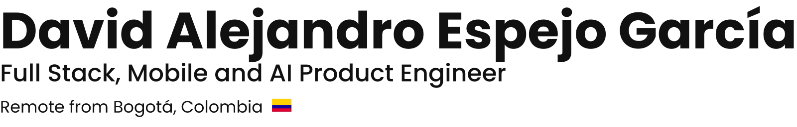
</picture>

I build web and mobile apps, document AI and AI powered SaaS that reach production, owning the whole arc from architecture to deployment. Cofounder and lead engineer at [Lumintik](https://www.lumintik.com), a software studio shipping for clients in Colombia, Mexico and the United States. I work with Claude Code every day, and I have taught engineering teams to do the same.

**Open to 100% remote roles.** &nbsp; [LinkedIn](https://www.linkedin.com/in/david-alejandro-espejo-garcia-298808216/) &nbsp;·&nbsp; [Email](mailto:davas.espejo@gmail.com) &nbsp;·&nbsp; [Instagram](https://www.instagram.com/davases22/)

### Selected work

<a href="https://apps.apple.com/app/futtem/id6739542468">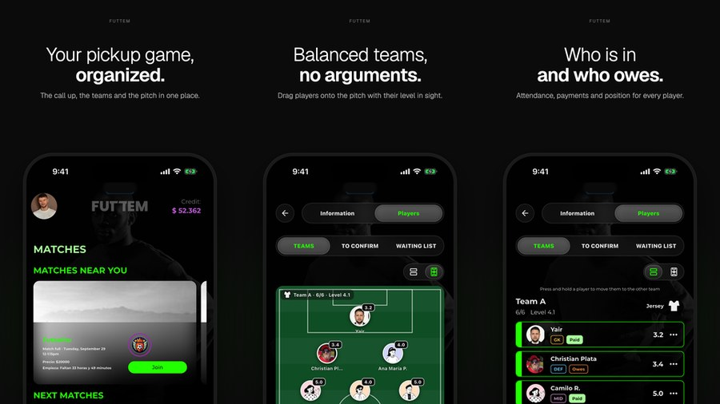</a>

**[FUTTEM](https://www.futtem.com)** &nbsp;🇨🇴  
Amateur football app on iPhone, iPad, Apple Watch and Android, live in both stores. I built the app and its wallet, chat and real time services.  
[App Store](https://apps.apple.com/app/futtem/id6739542468) &nbsp;·&nbsp; [Google Play](https://play.google.com/store/apps/details?id=com.futtem.app)

&nbsp;<a href="https://dart.dev">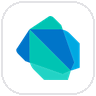</a>&nbsp;&nbsp;&nbsp;&nbsp;<a href="https://socket.io">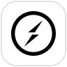</a>&nbsp;&nbsp;&nbsp;&nbsp;

 
 

<a href="https://www.attosound.com">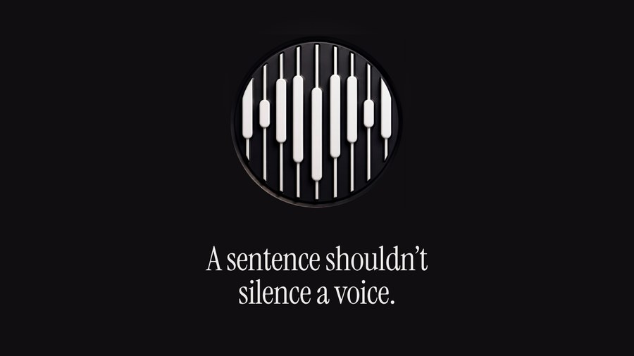</a>

**[ATTO Sound](https://www.attosound.com)** &nbsp;🇺🇸  
Creator platform for people who are incarcerated: an iOS app that turns prison phone calls into recorded in app VoIP calls. Sole engineer of the app and its services.  
[TestFlight beta](https://testflight.apple.com/join/m1EXaKAx) &nbsp;·&nbsp; [attosound.com](https://www.attosound.com)

&nbsp;&nbsp;&nbsp;&nbsp;<a href="https://www.rust-lang.org">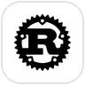</a>&nbsp;&nbsp;&nbsp;&nbsp;&nbsp;

 
 

<a href="https://www.ezdocu.ai">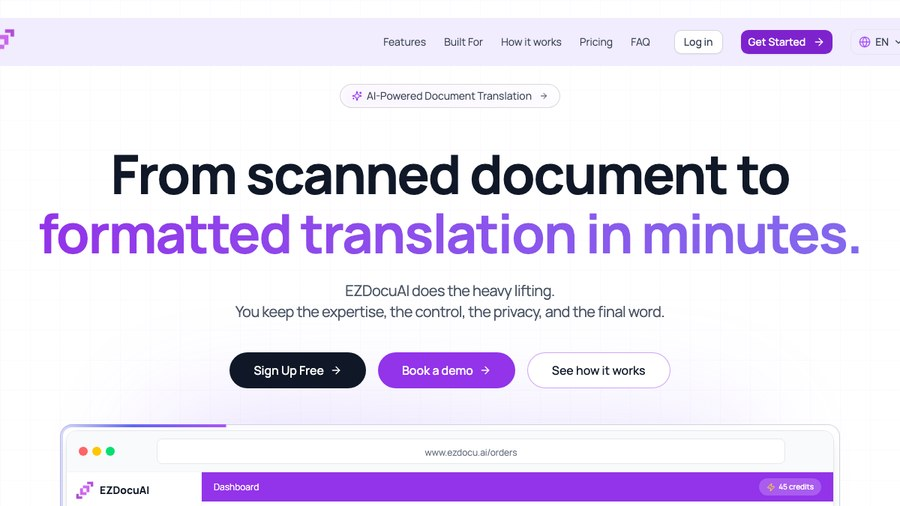</a>

**[EZDocu](https://www.ezdocu.ai)** &nbsp;🇺🇸 🇲🇽  
Lead engineer of the EZDocu OCR API, which turns scanned documents into structured data with LLMs. In production for [RECO](https://www.reco.com.mx) customs agencies in Mexico: more than 17,000 batches from 14 agencies in its first three months. I also contributed to the EZDocuAI translation workspace.  
[ezdocu.ai](https://www.ezdocu.ai)
&nbsp;&nbsp;&nbsp;&nbsp;&nbsp;&nbsp;&nbsp;&nbsp;
 
 

<a href="https://www.imagiq.com">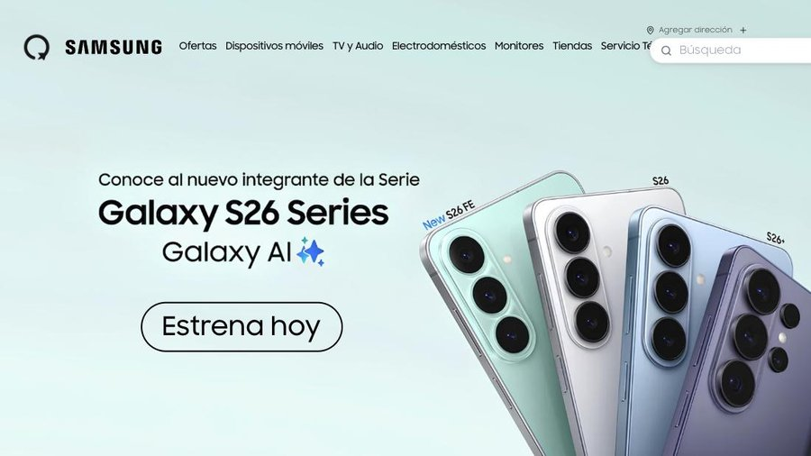</a>

**[iMagiQ, Samsung Store Colombia](https://www.imagiq.com)** &nbsp;🇨🇴  
Online store, in store kiosk and admin dashboard on eleven NestJS microservices, with local payments, shipping and an AI product categorizer.  
[imagiq.com](https://www.imagiq.com)

<a href="https://nextjs.org">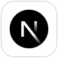</a>&nbsp;&nbsp;&nbsp;&nbsp;&nbsp;&nbsp;&nbsp;&nbsp;&nbsp;

 
 

<a href="https://www.ezmig.ai">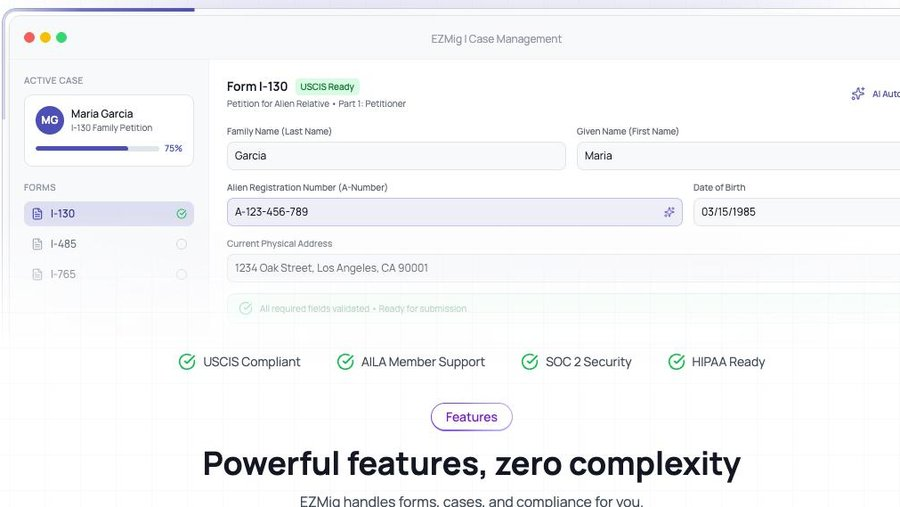</a>

**[EZMig](https://www.ezmig.ai)** &nbsp;🇺🇸  
Immigration case management with Claude powered form filling, passport reading and real time collaborative editing.  
[ezmig.ai](https://www.ezmig.ai)

&nbsp;&nbsp;&nbsp;&nbsp;&nbsp;&nbsp;&nbsp;&nbsp;<a href="https://www.docker.com">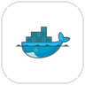</a>

 
 

<a href="https://www.accesify.com">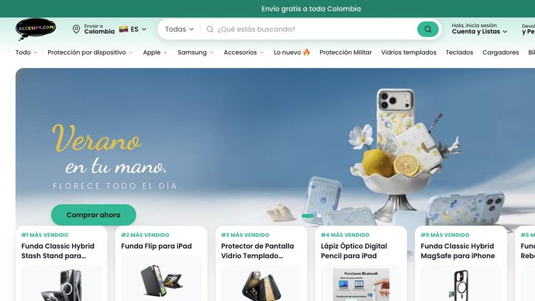</a>

**[Accesify](https://www.accesify.com)** &nbsp;🇨🇴  
My own phone accessories ecommerce with installment payments, on its own store and Mercado Libre, built on Medusa with 37 custom modules.  
[accesify.com](https://www.accesify.com)

&nbsp;&nbsp;&nbsp;&nbsp;&nbsp;&nbsp;

 
 

<a href="https://fridoom.com">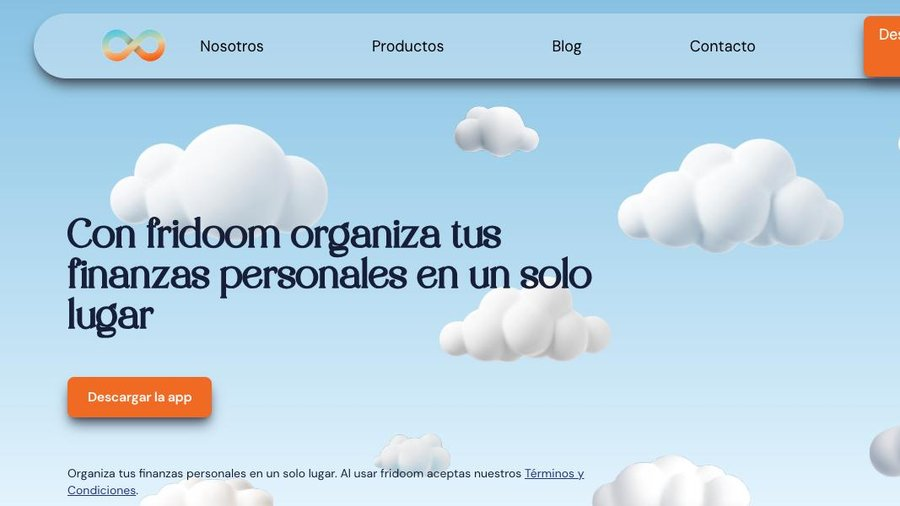</a>

**[Fridoom](https://fridoom.com)** &nbsp;🇨🇴  
My personal finance education brand that sells investing reports.  
[fridoom.com](https://fridoom.com)

&nbsp;&nbsp;&nbsp;

 
 

### Stack

**Frontend**  
&nbsp;&nbsp;&nbsp;

**Mobile**  
&nbsp;&nbsp;&nbsp;&nbsp;&nbsp;

**Backend**  
&nbsp;&nbsp;&nbsp;&nbsp;&nbsp;&nbsp;

**Data**  
&nbsp;&nbsp;&nbsp;&nbsp;&nbsp;&nbsp;

**AI**  
&nbsp;&nbsp;&nbsp;&nbsp;&nbsp;

**Cloud**  
&nbsp;&nbsp;&nbsp;&nbsp;

**Delivery**  
&nbsp;&nbsp;&nbsp;&nbsp;&nbsp;&nbsp;

### Background

B.Eng. in Mechatronic Engineering, [Universidad Militar Nueva Granada](https://umng.edu.co) 🇨🇴. Before building products full time I worked on CRM and cross selling for Colombia and Chile at [Rappi](https://www.rappi.com.co), on growth for the first [Colombia Tech Week](https://colombiatechweek.co), and on PLC automation for [Coca-Cola FEMSA](https://coca-colafemsa.com). Spanish native, English C1.
